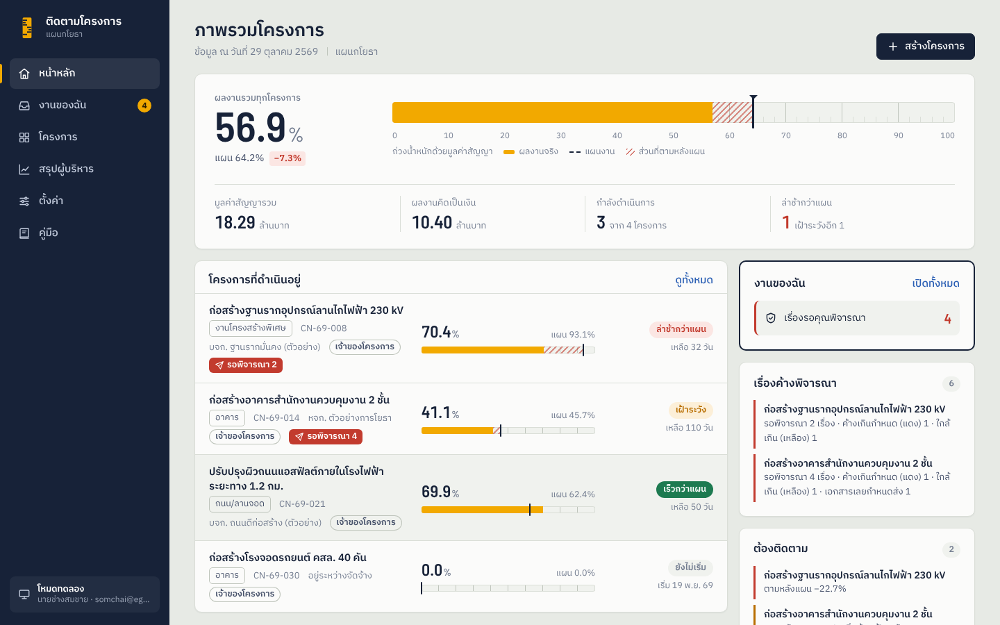
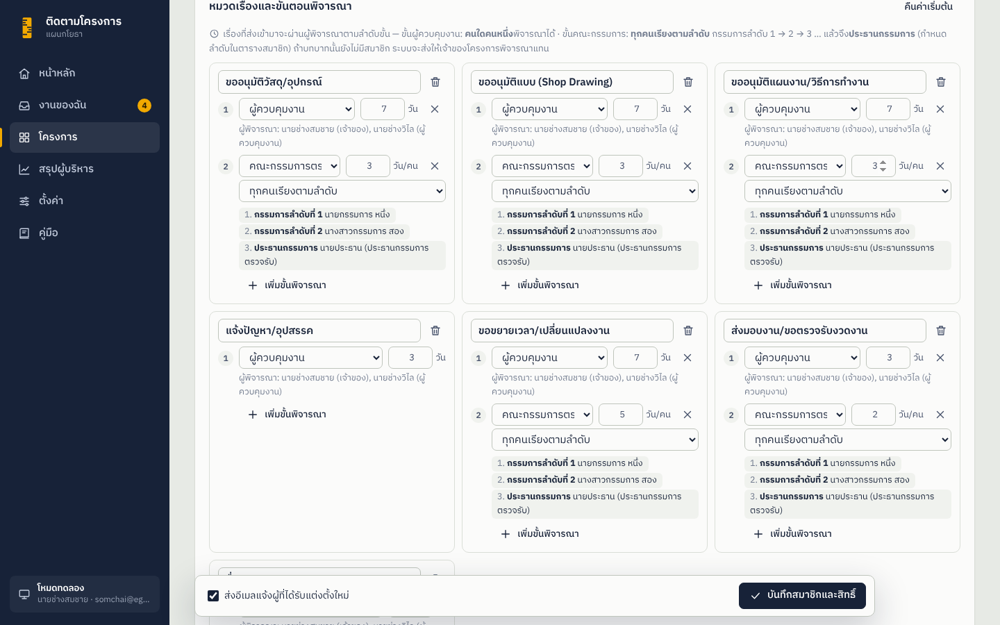
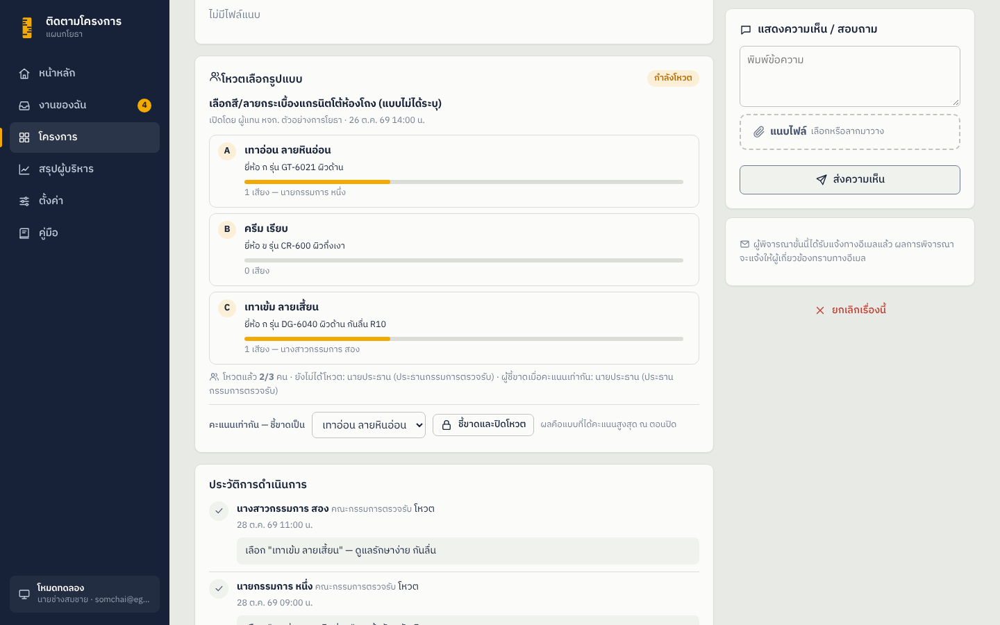
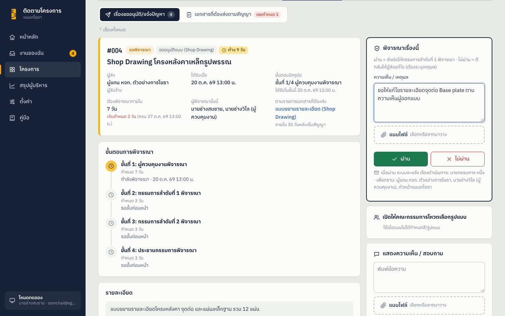
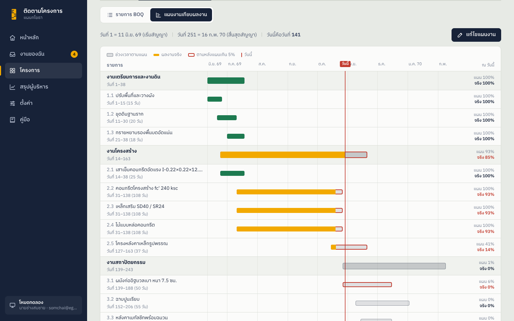

# ติดตามโครงการ — ระบบรวบรวมเอกสาร ติดตามความคืบหน้า และอนุมัติงานก่อสร้าง

เว็บแอปสำหรับรวบรวมเอกสารของแต่ละโครงการ ติดตามความคืบหน้าจาก BOQ รายสัปดาห์เทียบแผนงาน
ให้ผู้รับจ้างส่งเรื่องขออนุมัติหรือแจ้งปัญหาในระบบ ผู้ควบคุมงาน/คณะกรรมการพิจารณาผ่าน–ไม่ผ่านพร้อมเหตุผล
แจ้งเตือนทางอีเมลอัตโนมัติ และสรุปภาพรวมให้หัวหน้าใช้นำเสนอในแผนก

- **หน้าเว็บ** รันบน GitHub Pages (`https://<ชื่อผู้ใช้>.github.io/<ชื่อ repo>/`) ไม่ต้องมีเซิร์ฟเวอร์
- **ที่เก็บข้อมูลเลือกได้ 3 แบบ**
  - **Google Drive** — ข้อมูลใน Google Sheet ไฟล์ใน Google Drive ผ่าน Google Apps Script (ฟรี ตั้งค่าเองได้) ผู้ใช้เข้าระบบด้วย **อีเมล + รหัสยืนยัน 6 หลักทางอีเมล** ผู้รับจ้างภายนอกใช้ได้โดยไม่ต้องมีบัญชีพิเศษ
  - **SharePoint (Microsoft 365)** — ข้อมูลใน SharePoint List ไฟล์ในคลังเอกสารของไซต์ ทุกคนลงชื่อเข้าใช้ด้วยบัญชีองค์กร
  - **OneDrive** — ข้อมูล (JSON) และไฟล์อยู่ในโฟลเดอร์ OneDrive ของผู้ดูแล แชร์ให้ทีมด้วยปุ่มเดียว เหมาะกับทีมเล็กที่ไม่มีไซต์ SharePoint
- มี **โหมดทดลอง** ที่เก็บข้อมูลในเบราว์เซอร์ ใช้ลองระบบได้ทันที (สลับบทบาทเป็นผู้รับจ้าง/กรรมการเพื่อดูสิทธิ์ได้) และย้ายข้อมูลขึ้นที่เก็บจริงได้ภายหลัง

เวอร์ชันปัจจุบัน **1.0.2** — ดูสิ่งที่เปลี่ยนใน [CHANGELOG.md](CHANGELOG.md)
· **คู่มือการเข้าใช้งาน (ผู้ดูแลระบบ / ผู้ใช้) และการป้องกันสิทธิ์: [docs/USER-GUIDE.md](docs/USER-GUIDE.md)** (มีในเมนู "คู่มือ" ของเว็บด้วย)



---

## ความสามารถ

| ส่วน | ทำอะไรได้ |
|---|---|
| หน้าหลัก | ผลงานรวมทุกโครงการ (ถ่วงน้ำหนักด้วยมูลค่าสัญญา) เทียบแผน · **งานของฉัน** · เรื่องค้างพิจารณาแยกตามโครงการ · รายการ "ต้องติดตาม" · บันทึกล่าสุด |
| **งานของฉัน** | รวมทุกโครงการ: เรื่องที่รอคุณพิจารณา (เรียงจากค้างนานสุด) · เรื่องที่ไม่ผ่านและต้องแก้ไขส่งใหม่ · เอกสารที่ต้องส่งใกล้ครบกำหนด · เรื่องที่คุณส่งรอผล — มีตัวเลขเตือนบนเมนู |
| **สมาชิกและสิทธิ์** | ผู้สร้างโครงการเป็น **เจ้าของ** และเป็นผู้เดียวที่แต่งตั้งสมาชิกได้: ผู้ควบคุมงาน ผู้รับจ้าง คณะกรรมการตรวจรับ หัวหน้า/ผู้บริหาร ผู้ติดตาม (ระบุด้วยอีเมล) · ตารางสิทธิ์ของแต่ละบทบาทปรับได้ · เลือกระดับการรับอีเมลรายคน · ส่งอีเมลแจ้งการแต่งตั้ง · โอนความเป็นเจ้าของ |
| **เรื่องขออนุมัติ / แจ้งปัญหา** | ผู้รับจ้างส่งเรื่องพร้อมไฟล์แนบ → ผู้พิจารณาแต่ละขั้นกด **ผ่าน / ไม่ผ่าน (ต้องระบุเหตุผล)** → ผู้ส่งแก้ไขส่งใหม่ได้ · ขั้นตอนพิจารณาหลายขั้นตามหมวด (เช่น ผู้ควบคุมงาน 3 วัน → คณะกรรมการ 5 วัน) · แสดง **วัน–เวลาที่ได้รับ ต้องพิจารณาภายในกี่วัน ถึงขั้นไหน ค้างกี่วัน** · **สีเหลืองเมื่อค้างเกิน 7 วัน สีแดงเมื่อค้างเกิน 14 วัน** (ปรับได้) · ประวัติการดำเนินการครบ · ความเห็น/สอบถาม |
| **อนุมัติเรียงลำดับ** | ผู้ควบคุมงาน (คนใดก็ได้) → **กรรมการลำดับที่ 1 → 2 → 3 … → ประธานกรรมการ** (คนสุดท้าย) · เจ้าของโครงการกำหนดลำดับกรรมการในตารางสมาชิก · ขั้นคณะกรรมการเลือก "ทุกคนเรียงตามลำดับ" หรือ "คนใดคนหนึ่ง" ได้ต่อหมวด |
| **โหวตเลือกรูปแบบ/สี** | เมื่อแบบไม่ได้กำหนดสี/ลาย เสนอตัวเลือกพร้อมรูปตัวอย่างให้คณะกรรมการโหวต · เสียงข้างมากชนะ คะแนนเท่ากันประธานกรรมการชี้ขาด · ขั้นคณะกรรมการอนุมัติได้หลังได้ข้อยุติ |
| **หมวดเรื่อง** | ขออนุมัติวัสดุ/อุปกรณ์ · ขออนุมัติแบบ (Shop Drawing) · ขออนุมัติแผนงาน/วิธีการทำงาน · แจ้งปัญหา/อุปสรรค · ขอขยายเวลา/เปลี่ยนแปลงงาน · ส่งมอบงาน/ขอตรวจรับงวดงาน · อื่นๆ — เพิ่ม/แก้หมวดและขั้นตอนได้ต่อโครงการ ค้นหาและกรองตามหมวด/สถานะ |
| **เอกสารที่ต้องส่งตามสัญญา** | รายการเอกสารพร้อมกำหนดส่ง เช่น "ภายใน 15 วันหลังเริ่มสัญญา" "ก่อนสิ้นสุดสัญญา 30 วัน" หรือวันที่ระบุ · ระบบคำนวณวันครบกำหนด แสดง **ส่งแล้วหรือยัง ส่งตรงเวลา/ช้ากี่วัน เลยกำหนดกี่วัน** · มีแม่แบบให้เริ่ม |
| **อีเมลแจ้งเตือน** | แจ้งผู้ต้องพิจารณาทันทีที่มีเรื่องเข้า · แจ้งผู้ส่งและผู้เกี่ยวข้องเมื่อมีผลการพิจารณา · หัวหน้ารับเฉพาะผลการพิจารณาและการอัปเดตความคืบหน้า (หรือตามที่กำหนด) · Google: **เตือนงานค้างรายวัน** และเตือนผู้รับจ้างก่อนครบกำหนดส่งเอกสาร |
| BOQ | ใส่รายการตาม ปร.4 · นำเข้าจาก Excel/CSV · วางจาก Excel · ส่งออก Excel |
| **แผนงานเทียบผลงาน (Gantt)** | กำหนดวันเริ่ม–วันจบของแต่ละรายการ BOQ เป็น "วันที่ของสัญญา" (เช่น สัญญา 10 วัน เทคอนกรีตวันที่ 3–5) หรือวันที่ปฏิทิน · กรอกทีเดียวทั้งหมวดได้ · แผนภูมิแท่งแสดงช่วงแผนกับผลงานจริง เส้นวันนี้ และรายการที่ตามหลังแผน · ใช้เป็นเส้นแผนใน S-Curve ได้ |
| บันทึกความคืบหน้า | กรอกปริมาณที่ทำได้หรือ % สะสม ระบบคำนวณและเทียบแผนทันที · ผลการดำเนินงาน ปัญหา รูปถ่าย · **แจ้งอีเมลหัวหน้า/ผู้ติดตาม** |
| เอกสาร | อัปโหลดทุกประเภทแยกหมวด · ลากวาง · ดูตัวอย่าง · ไฟล์แนบของเรื่องขออนุมัติเก็บในหมวด "เอกสารแนบเรื่องขออนุมัติ" (เก็บเป็นหลักฐาน ลบได้เฉพาะเจ้าของโครงการ) |
| สรุปผู้บริหาร | ตารางสรุปทุกโครงการพร้อม **เรื่องค้างพิจารณา (เหลือง/แดง)** · ส่งออก Excel · พิมพ์/PDF · โหมดนำเสนอเต็มจอ |
| ผู้ดูแลระบบ | กำหนดผู้ดูแลระบบ ผู้บริหาร (ดูทุกโครงการ) ผู้ที่สร้างโครงการได้ (อีเมลหรือโดเมน เช่น `@egat.co.th`) และเกณฑ์สีเหลือง/แดงกลาง |

| ลำดับการพิจารณาของคณะกรรมการ | โหวตเลือกรูปแบบ/สี |
|---|---|
|  |  |

---

## บทบาทและสิทธิ์

ทุกคนในโครงการ**ดูข้อมูลของโครงการได้ทั้งหมด** ส่วนการแก้ไขเป็นไปตามตารางนี้ (เจ้าของโครงการปรับได้ที่แท็บ **สมาชิกและสิทธิ์**)

| สิทธิ์ | เจ้าของ | ผู้ควบคุมงาน | คณะกรรมการ | ผู้รับจ้าง | หัวหน้า | ผู้ติดตาม |
|---|:-:|:-:|:-:|:-:|:-:|:-:|
| แต่งตั้ง/ถอดถอนสมาชิก กำหนดสิทธิ์และขั้นตอนพิจารณา | ✓ | | | | | |
| แก้ไขข้อมูลและตั้งค่าโครงการ | ✓ | ✓ | | | | |
| แก้ไข BOQ และแผนงาน | ✓ | ✓ | | | | |
| บันทึกความคืบหน้า | ✓ | ✓ | | | | |
| อัปโหลด/จัดการคลังเอกสาร | ✓ | ✓ | | | | |
| ส่งเรื่องขออนุมัติ/แจ้งปัญหา | ✓ | ✓ | ✓ | ✓ | | |
| พิจารณาผ่าน/ไม่ผ่าน (ในขั้นของบทบาทตน) | ✓ | ✓ | ✓ | | | |
| กำหนดรายการเอกสารที่ต้องส่ง | ✓ | ✓ | | | | |

- **เจ้าของโครงการ** = ผู้สร้างโครงการ เลือกได้ว่าตัวเองทำหน้าที่ใดในงาน (ค่าเริ่มต้น: ผู้ควบคุมงาน → ได้รับเรื่องให้พิจารณาด้วย)
- **ผู้พิจารณาแต่ละขั้น** — ขั้นผู้ควบคุมงาน: คนใดคนหนึ่งกดก็ได้ · ขั้นคณะกรรมการ (ค่าเริ่มต้น): **กรรมการลำดับที่ 1 → 2 → 3 … → ประธานกรรมการ** ทีละคน แต่ละคนพิจารณาได้เมื่อถึงลำดับของตน และเจ้าของโครงการพิจารณาแทนไม่ได้ · ถ้ายังไม่มีสมาชิกบทบาท/ลำดับนั้น ระบบส่งให้เจ้าของโครงการพิจารณาแทน · ผู้ส่งพิจารณาเรื่องของตัวเองไม่ได้
- **โหวต** — กรรมการทุกลำดับโหวตได้คนละ 1 เสียง · ปิดโหวต/ชี้ขาด: ประธานกรรมการหรือเจ้าของโครงการ
- **ผู้ดูแลระบบ** ดู/แก้ไขได้ทุกโครงการ (ยกเว้นพิจารณาเรื่องและแต่งตั้งสมาชิก) เปลี่ยนค่ากลาง และโอนความเป็นเจ้าของโครงการได้ · **ผู้บริหาร** ดูได้ทุกโครงการแบบอ่านอย่างเดียว
- ผู้ที่ไม่ได้เป็นสมาชิก จะ**ไม่เห็นโครงการนั้นเลย**

### ใครได้รับอีเมลเมื่อไร

| เหตุการณ์ | ต้องดำเนินการ | เพื่อทราบ |
|---|---|---|
| ส่งเรื่อง / ส่งใหม่ | ผู้พิจารณาขั้นแรก | ผู้ที่ตั้งรับ "ทุกเรื่องในโครงการ" |
| ผ่านขั้นหนึ่ง ส่งต่อขั้นถัดไป | ผู้พิจารณาขั้นถัดไป | ผู้ส่ง · ผู้พิจารณาก่อนหน้า · ผู้ที่รับ "ทุกเรื่อง" หรือ "ผลการพิจารณา" |
| ผ่าน (อนุมัติ) / ไม่ผ่าน (พร้อมเหตุผล) | – | ผู้ส่ง · ผู้พิจารณา · ผู้ที่รับ "ทุกเรื่อง" หรือ "ผลการพิจารณา" (หัวหน้า) |
| ความเห็นใหม่ / ยกเลิกเรื่อง | – | ผู้ส่ง · ผู้พิจารณาปัจจุบัน · ผู้ที่รับ "ทุกเรื่อง" |
| บันทึกความคืบหน้า (ติ๊ก "แจ้งอีเมล") | – | ผู้ที่รับ "ทุกเรื่อง" หรือ "ผลการพิจารณาและการอัปเดตความคืบหน้า" (หัวหน้า) |
| แต่งตั้งสมาชิกใหม่ | – | ผู้ที่ได้รับแต่งตั้ง |
| เตือนรายวัน (Google) | ผู้พิจารณาของเรื่องที่ค้างครบ 7 / 14 วัน หรือเลยกำหนด · ผู้รับจ้างเมื่อเอกสารใกล้/เลยกำหนดส่ง | – |

ระดับการรับอีเมลรายคน: **ทุกเรื่องในโครงการ** · **เฉพาะผลการพิจารณาและการอัปเดตความคืบหน้า** (ค่าเริ่มต้นของหัวหน้า) · **เฉพาะเรื่องที่ตนส่งหรือต้องพิจารณา** · **ไม่รับอีเมลแจ้งเพื่อทราบ** — ผู้ที่ต้องพิจารณาได้รับอีเมลเสมอ



### สีของเรื่องที่รอพิจารณา

นับจาก **วันและเวลาที่ได้รับเรื่องในขั้นตอนปัจจุบัน**

- 🟢 ปกติ
- 🟡 **สีเหลือง** — ค้างตั้งแต่ 7 วัน หรือเลยกำหนดพิจารณาของขั้นนั้นแล้ว (เช่น แจ้งปัญหาต้องตอบใน 3 วัน)
- 🔴 **สีแดง** — ค้างตั้งแต่ 14 วัน

ตัวเลข 7/14 วันตั้งเป็นค่ากลางได้ที่หน้า **ตั้งค่า** และตั้งแยกรายโครงการได้ที่แท็บ **สมาชิกและสิทธิ์**

---

## โครงสร้างไฟล์

```
project-tracker/
├── index.html                 หน้าเว็บหลัก
├── auth.html                  หน้ารับผลการลงชื่อเข้าใช้ Microsoft (ใช้กับ SharePoint / OneDrive)
├── assets/
│   ├── css/styles.css         หน้าตาทั้งหมด
│   └── js/
│       ├── app.js             จุดเริ่มต้น เมนู เส้นทางหน้า และการเข้าสู่ระบบ
│       ├── rules.js           กฎกลาง: บทบาท สิทธิ์ ขั้นตอนอนุมัติ ผู้รับอีเมล รูปแบบอีเมล (ใช้ร่วมกับ Code.gs)
│       ├── store.js           ชั้นข้อมูล (เรียกที่เก็บที่เลือกไว้ ตรวจสิทธิ์ ส่งอีเมล)
│       ├── config.js          ค่าตั้งค่าของเครื่องนี้
│       ├── backends/          ตัวเชื่อม Google / SharePoint / OneDrive และการลงชื่อเข้าใช้ Microsoft
│       ├── calc.js            สูตรคำนวณความคืบหน้า แผนงาน (รวมแผนราย BOQ) สถานะ
│       ├── charts.js          กราฟ S-Curve
│       ├── excel.js           อ่าน/เขียน Excel และ CSV
│       ├── demo.js            ข้อมูลตัวอย่าง (มีสมาชิก เรื่องขออนุมัติ และแผนงาน)
│       └── views/             แต่ละหน้าจอ (tab-members, tab-subs, vote, tab-plan, inbox, help, login ฯลฯ)
├── backend/
│   ├── Code.gs                โค้ดฝั่ง Google Apps Script (วางใน Apps Script ทั้งไฟล์)
│   └── appsscript.json        ไฟล์ตั้งค่า Apps Script (ไม่บังคับ)
├── tools/sync-rules.mjs       (สำหรับผู้พัฒนา) คัดลอก rules.js ไปไว้ท้าย Code.gs
├── templates/BOQ_template.csv แม่แบบ BOQ สำหรับนำเข้า
├── CHANGELOG.md               บันทึกการเปลี่ยนแปลงแต่ละเวอร์ชัน
└── docs/                      เอกสารประกอบ (USER-GUIDE.md = คู่มือเข้าใช้งานและสิทธิ์) และภาพหน้าจอ
```

---

## ลองใช้บนเครื่องก่อน (ไม่ต้องตั้งค่าอะไร)

ไฟล์ JavaScript เป็นแบบ module จึง**ดับเบิลคลิกเปิด index.html ตรงๆ ไม่ได้** ให้เปิดผ่านเว็บเซิร์ฟเวอร์เล็กๆ:

```bash
cd ~/Desktop/project-tracker
python3 -m http.server 8000
```

แล้วเปิด <http://localhost:8000> ใส่ชื่อและอีเมล เลือก **"ลองด้วยข้อมูลตัวอย่าง"** — คุณจะเป็นเจ้าของโครงการตัวอย่าง (ทำหน้าที่ผู้ควบคุมงาน) มีเรื่องรอพิจารณาหลายสถานะ

**ทดลองสิทธิ์ของบทบาทอื่น:** หน้า **ตั้งค่า → บัญชีของฉัน → ทดลองใช้งานในนามผู้อื่น** เลือกผู้รับจ้าง กรรมการ หรือหัวหน้า แล้วดูว่าเห็นและทำอะไรได้บ้าง
อีเมลที่ระบบจะส่งดูได้ใน **กล่องอีเมลจำลอง** ที่หน้าตั้งค่า (โหมดทดลองไม่ได้ส่งอีเมลจริง)

---

## ติดตั้งใช้งานจริง (ทำครั้งเดียว)

### ขั้นที่ 1 — เลือกที่เก็บข้อมูล

| | Google Drive | SharePoint (Microsoft 365) |
|---|---|---|
| ต้องพึ่งฝ่าย IT | ไม่ต้อง ใช้บัญชี Google ใดก็ได้ | ต้องให้ผู้ดูแล Microsoft 365 ลงทะเบียนแอปและอนุมัติสิทธิ์ |
| การเข้าระบบ | อีเมล + รหัส 6 หลักทางอีเมล (ใช้อีเมลอะไรก็ได้ รวมผู้รับจ้างภายนอก) | บัญชี Microsoft ขององค์กร (คนนอกต้องเป็นบัญชี Guest ของ tenant) |
| การตรวจสิทธิ์ | **ที่เซิร์ฟเวอร์** (Apps Script) ผู้ที่ไม่ใช่สมาชิกไม่ได้รับข้อมูลโครงการนั้นเลย | ที่หน้าเว็บ + สิทธิ์ของไซต์ SharePoint (สมาชิกไซต์อ่านรายการ `PT_*` ได้ทั้งหมดด้วยเครื่องมือของ SharePoint) |
| อีเมลแจ้งเตือน | ส่งจาก Gmail ของบัญชีที่ติดตั้ง (ฟรี 100 ผู้รับ/วัน · Google Workspace 1,500/วัน) + เตือนรายวัน | ส่งจากกล่องจดหมายของผู้ทำรายการ (ต้องเพิ่มสิทธิ์ `Mail.Send`) ไม่มีเตือนรายวัน |
| ขนาดไฟล์ต่อไฟล์ (ผ่านเว็บ) | 25 MB | 2 GB |
| ดูตัวอย่าง Word/Excel/PDF | Google Drive viewer (ต้องเป็นบัญชี Google — ระบบแชร์โฟลเดอร์โครงการให้สมาชิกอัตโนมัติ) | Office Online |
| เหมาะกับ | เริ่มใช้เร็ว ทำงานร่วมกับผู้รับจ้างภายนอก | เอกสารภายในองค์กรที่ใช้ Microsoft 365 อยู่แล้ว |

เลือกอย่างใดอย่างหนึ่ง แล้วทำตามขั้นที่ 1A หรือ 1B

### ขั้นที่ 1A — ตั้งค่าฝั่ง Google (ที่เก็บข้อมูล ไฟล์ และอีเมล)

ทำด้วยบัญชี Google ที่จะเป็น "เจ้าของ" ข้อมูล (ไฟล์ทั้งหมดจะอยู่ใน Drive ของบัญชีนี้ อีเมลแจ้งเตือนส่งจากบัญชีนี้ และบัญชีนี้เป็น**ผู้ดูแลระบบ**)
แนะนำให้ใช้บัญชีกลางของแผนก หรือบัญชี Google Workspace เพื่อโควตาอีเมลที่มากกว่า

1. ไปที่ Google Drive → **ใหม่ → Google ชีต** ตั้งชื่อเช่น `ระบบติดตามโครงการ - ฐานข้อมูล`
2. ในชีต เปิดเมนู **ส่วนขยาย → Apps Script** (Extensions → Apps Script)
3. ลบโค้ดเดิมในไฟล์ `Code.gs` ทิ้ง แล้ววางโค้ดทั้งหมดจาก `backend/Code.gs` → กด 💾 บันทึก
4. แก้ค่าที่ส่วน `CONFIG` ด้านบนของโค้ด (ไม่บังคับ แต่แนะนำ)
   ```js
   ROOT_FOLDER_ID: 'https://drive.google.com/drive/folders/xxxxxxxx', // โฟลเดอร์เก็บไฟล์ (เว้นว่าง = สร้างให้)
   ADMIN_EMAILS: 'boss@egat.co.th',                                    // ผู้ดูแลระบบเพิ่มเติม
   APP_URL: 'https://<ชื่อผู้ใช้>.github.io/project-tracker/',          // ลิงก์ในอีเมล
   REMINDER_HOUR: 8,                                                    // เวลาส่งอีเมลเตือนงานค้างรายวัน
   ```
5. เลือกฟังก์ชัน **`setup`** จากเมนูดรอปดาวน์ด้านบน → กด **▶ เรียกใช้** (Run)
   - Google จะขอสิทธิ์ (Sheet, Drive, **ส่งอีเมล**, **ตั้งเวลาทำงาน**) → **ตรวจสอบสิทธิ์** → เลือกบัญชี
   - ถ้าขึ้น "Google ไม่ได้ยืนยันแอปนี้" → กด **ขั้นสูง** → **ไปที่ … (ไม่ปลอดภัย)** → **อนุญาต** (เป็นโค้ดของเราเอง)
   - ดูที่ **บันทึกการดำเนินการ** จะเห็น **รหัสเข้าใช้งาน (Access key)** เช่น `PT-3E410ED714` → จดไว้ และระบบตั้งเวลาเตือนงานค้างรายวันให้แล้ว
6. กด **การทำให้ใช้งานได้ → การทำให้ใช้งานได้รายการใหม่** (Deploy → New deployment)
   - ⚙️ เลือกประเภท: **เว็บแอป** (Web app)
   - ดำเนินการในฐานะ (Execute as): **ฉัน** (Me)
   - ผู้ที่มีสิทธิ์เข้าถึง (Who has access): **ทุกคน** (Anyone)
   - กด **ทำให้ใช้งานได้** → คัดลอก **URL ของเว็บแอป** ที่ลงท้ายด้วย `/exec`

> **ความปลอดภัย:** ทุกคำขอต้องมี **รหัสเข้าใช้งาน** (อยู่ในลิงก์เชิญทีม) และต้อง**ยืนยันอีเมลด้วยรหัส 6 หลัก** ทุกคำสั่งตรวจสิทธิ์ตามบทบาทที่เซิร์ฟเวอร์
> ผู้ที่เข้าสู่ระบบได้: ผู้ดูแลระบบ ผู้บริหาร ผู้ที่สร้างโครงการได้ และสมาชิกของโครงการใดโครงการหนึ่ง (ถ้า "ผู้ที่สร้างโครงการได้" เว้นว่าง ทุกคนที่มีลิงก์เชิญเข้าระบบได้)

#### อัปเดตจากเวอร์ชัน 1.0.0

1. เปิด Apps Script เดิม → วางโค้ด `backend/Code.gs` ใหม่แทนทั้งไฟล์ (ค่าใน `CONFIG` เดิม เช่น `ROOT_FOLDER_ID` ให้ใส่กลับ) → บันทึก
2. รัน **`setup`** อีกครั้ง เพื่ออนุญาตสิทธิ์ส่งอีเมลและตั้งเวลา (ข้อมูลเดิมไม่หาย ชีตได้คอลัมน์/ชีตใหม่อัตโนมัติ)
3. **การทำให้ใช้งานได้ → จัดการการทำให้ใช้งานได้ → ✏️ แก้ไข → เวอร์ชัน: เวอร์ชันใหม่ → ทำให้ใช้งานได้** (URL เดิมใช้ต่อได้)
4. อัปโหลดไฟล์หน้าเว็บชุดใหม่ขึ้น GitHub Pages ทุกคนจะเห็นหน้าต่าง **เข้าสู่ระบบด้วยอีเมล** ในครั้งแรก
5. โครงการเดิมยังไม่มีเจ้าของ — ผู้ดูแลระบบทำหน้าที่แทน เปิดแท็บ **สมาชิกและสิทธิ์** ของแต่ละโครงการ กด **รับเป็นเจ้าของ** หรือ **กำหนดเจ้าของโครงการ** แล้วแต่งตั้งสมาชิก

### ขั้นที่ 1B — ตั้งค่าฝั่ง SharePoint (Microsoft 365)

ระบบใช้ **SharePoint List** 7 รายการเป็นฐานข้อมูล (`PT_Projects`, `PT_BOQ`, `PT_Updates`, `PT_Files`, `PT_Settings`, `PT_Submissions`, `PT_Required`) และเก็บไฟล์ใน **คลังเอกสาร (Documents)** ของไซต์ แยกโฟลเดอร์ `ProjectTracker/<รหัส ชื่อโครงการ>/<หมวดเอกสาร>/`

**ส่วนที่ต้องขอจากฝ่าย IT / ผู้ดูแล Microsoft 365** (ตั้งแต่ปี 2025 Microsoft ไม่ให้ผู้ใช้ทั่วไปอนุมัติสิทธิ์เข้าถึง SharePoint ให้แอปเอง)

1. **Microsoft Entra admin center → Applications → App registrations → New registration**
   - Name: `ระบบติดตามโครงการ` · Supported account types: **Accounts in this organizational directory only**
2. **Authentication → Add a platform → Single-page application** → Redirect URI:
   `https://<ชื่อผู้ใช้>.github.io/<ชื่อ repo>/auth.html` (คัดลอกได้จากหน้าตั้งค่าของเว็บ)
   ถ้าจะทดสอบบนเครื่องด้วย ให้เพิ่ม `http://localhost:8000/auth.html` อีกรายการ
3. **API permissions → Add a permission → Microsoft Graph → Delegated permissions** เลือก
   - `Sites.ReadWrite.All` — อ่าน/เขียนรายการและไฟล์ (ใช้งานประจำ)
   - `Sites.Manage.All` — สร้างรายการข้อมูลในไซต์ (ใช้ตอนตั้งค่าและอัปเดตโครงสร้าง)
   - `Mail.Send` — (ถ้าต้องการอีเมลแจ้งเตือน) ส่งอีเมลจากกล่องจดหมายของผู้ทำรายการ

   แล้วกด **Grant admin consent for <องค์กร>**
   > ถ้าฝ่าย IT ต้องการจำกัดให้แอปเข้าได้เฉพาะไซต์เดียว ให้ใช้ `Sites.Selected` แทน แล้วให้สิทธิ์แอประดับ `manage` เฉพาะไซต์นั้น จากนั้นเลือก "Sites.Selected" ในช่องระดับสิทธิ์ที่หน้าตั้งค่า
4. ส่ง **Application (client) ID** และ **Directory (tenant) ID** (หรือโดเมนองค์กร) ให้ผู้ตั้งค่าระบบ
5. สร้างหรือเลือกไซต์ SharePoint เช่น `https://<องค์กร>.sharepoint.com/sites/CivilProjects` แล้วเพิ่มทุกคนที่จะใช้งานเป็น **สมาชิก (สิทธิ์แก้ไข)** — ผู้รับจ้างภายนอกต้องเชิญเป็น **Guest** ของ tenant ก่อน

**ส่วนที่ผู้ใช้ทำเอง** (หลังจากนำเว็บขึ้น GitHub Pages ในขั้นที่ 2 แล้ว)

1. เปิดเว็บ → **ตั้งค่า** → เลือก **SharePoint (Microsoft 365)**
2. ใส่ Tenant, Application (client) ID, URL ของไซต์ และชื่อโฟลเดอร์เก็บไฟล์
3. กด **ลงชื่อเข้าใช้และตรวจสอบ** → ลงชื่อเข้าใช้ในหน้าต่างของ Microsoft (ต้องอนุญาต pop-up)
4. ครั้งแรกจะมีปุ่ม **สร้างรายการข้อมูลในไซต์** → กดครั้งเดียว (ผู้กดต้องมีสิทธิ์จัดการไซต์)
5. กด **บันทึกและเชื่อมต่อ**
6. ผู้ที่กด **สร้างรายการข้อมูลในไซต์** ถูกบันทึกเป็น**ผู้ดูแลระบบ**อัตโนมัติ (เพิ่มคนอื่นได้ที่หัวข้อ **ผู้ใช้และสิทธิ์ของระบบ**) และติ๊ก **ส่งอีเมลแจ้งเตือนผ่าน Microsoft 365** ถ้าขอสิทธิ์ `Mail.Send` แล้ว
7. ใช้ **ลิงก์เชิญทีม** ส่งให้เพื่อน (ลิงก์ไม่มีรหัสลับ)

### ขั้นที่ 1C — ตั้งค่าฝั่ง OneDrive

ข้อมูลเก็บเป็นไฟล์ในโฟลเดอร์ OneDrive ของผู้ดูแล:

```
<โฟลเดอร์หลัก เช่น ProjectTracker>/
  _data/settings.json              ค่ากลาง (ผู้ดูแลระบบ ผู้บริหาร ฯลฯ)
  _data/project-<รหัส>.json         ข้อมูลโครงการละ 1 ไฟล์ (โครงการ BOQ ความคืบหน้า เรื่องขออนุมัติ เอกสารที่ต้องส่ง รายชื่อไฟล์)
  <รหัส ชื่อโครงการ>/<หมวดเอกสาร>/   ไฟล์เอกสาร
```

1. ลงทะเบียนแอปแบบเดียวกับ SharePoint (Single-page application + Redirect URI `…/auth.html`) แต่สิทธิ์ Microsoft Graph แบบ Delegated เป็น
   - `Files.ReadWrite` — ผู้ดูแลเปิดโฟลเดอร์ใน OneDrive ของตนเอง (ผู้ใช้อนุมัติเองได้)
   - `Files.ReadWrite.All` — สมาชิกเปิดโฟลเดอร์ที่ถูกแชร์มา (**องค์กรส่วนใหญ่ต้องให้ผู้ดูแล Microsoft 365 กด Grant admin consent** ตามนโยบายของ Microsoft ตั้งแต่ปี 2025)
   - `Mail.Send` — ถ้าต้องการอีเมลแจ้งเตือน
   - บัญชี Microsoft ส่วนตัว (outlook.com) ใช้ได้ ถ้าลงทะเบียนแอปแบบรองรับ personal accounts และใส่ Tenant เป็น `consumers` หรือ `common`
2. เปิดเว็บ → **ตั้งค่า** → **OneDrive** → ใส่ Client ID และชื่อโฟลเดอร์ → **ลงชื่อเข้าใช้และตรวจสอบ** → **สร้างโฟลเดอร์ข้อมูล** → **บันทึกและเชื่อมต่อ**
   (เจ้าของ OneDrive เป็น**ผู้ดูแลระบบ**เสมอ)
3. สร้างโครงการและแต่งตั้งสมาชิก แล้วกด **ให้สิทธิ์เข้าถึงโฟลเดอร์** — ระบบแชร์โฟลเดอร์หลักให้ทุกคน: **แก้ไขได้** สำหรับผู้ที่ต้องบันทึก (เจ้าของ ผู้ควบคุมงาน กรรมการ ผู้รับจ้าง) และ **ดูอย่างเดียว** สำหรับหัวหน้า ผู้ติดตาม และผู้บริหาร
4. ส่ง **ลิงก์เชิญทีม** (ไม่มีรหัสลับ) — สมาชิกเปิดลิงก์แล้วลงชื่อเข้าใช้ด้วยบัญชี Microsoft ที่ได้รับแชร์
5. เมื่อถอดสมาชิกออกจากโครงการ ให้ถอนสิทธิ์ใน OneDrive (โฟลเดอร์หลัก → จัดการการเข้าถึง) ด้วย

> **อัปเดตจาก 1.0.0:** ไซต์เดิมยังใช้งานส่วนเดิมได้ ผู้ดูแลเปิดหน้า **ตั้งค่า** แล้วกด **อัปเดตโครงสร้างข้อมูลในไซต์** (สร้าง `PT_Submissions` และ `PT_Required`) เพื่อใช้เรื่องขออนุมัติ

### ขั้นที่ 2 — นำหน้าเว็บขึ้น GitHub Pages

1. เข้า <https://github.com/new> สร้าง repository ใหม่ เช่น `project-tracker` เลือก **Public**
   (บัญชีฟรีเปิด GitHub Pages ได้เฉพาะ repo แบบ Public — ในโค้ดไม่มีข้อมูลโครงการหรือรหัสใดๆ ข้อมูลจริงอยู่ใน Google/SharePoint ทั้งหมด)
2. ในหน้า repo กด **Add file → Upload files** แล้วลาก**ไฟล์และโฟลเดอร์ทั้งหมดที่อยู่ข้างใน** `project-tracker` (ไม่ใช่ตัวโฟลเดอร์ และต้องมี `auth.html` ด้วย) ไปวาง → **Commit changes**
   - ไฟล์ `.nojekyll` เป็นไฟล์ซ่อน บน Mac กด `Cmd + Shift + .` เพื่อให้เห็นแล้วลากไปด้วย
3. ไปที่ **Settings → Pages** → Source: **Deploy from a branch** → Branch: **main** / **(root)** → **Save**
4. รอ 1–2 นาที เว็บจะอยู่ที่ `https://<ชื่อผู้ใช้>.github.io/project-tracker/`

ถ้าใช้ git:

```bash
cd ~/Desktop/project-tracker
git init && git add . && git commit -m "ระบบติดตามโครงการ 1.0.1"
git branch -M main
git remote add origin https://github.com/<ชื่อผู้ใช้>/project-tracker.git
git push -u origin main
```

### ขั้นที่ 3 — เชื่อมหน้าเว็บกับที่เก็บข้อมูล

- **Google Drive:** เมนู **ตั้งค่า** → เลือก **Google Drive** → วาง **URL ของเว็บแอป** และ **รหัสเข้าใช้งาน** → **ทดสอบการเชื่อมต่อ** → **บันทึกและเชื่อมต่อ** → เข้าสู่ระบบด้วยอีเมลของบัญชีที่ติดตั้ง (ผู้ดูแลระบบ)
- **SharePoint:** ทำตาม "ส่วนที่ผู้ใช้ทำเอง" ในขั้นที่ 1B

จากนั้น
1. ถ้าเคยลองใส่ข้อมูลในโหมดทดลองไว้ จะมีปุ่ม **ย้ายข้อมูล** ขึ้นที่เก็บที่เชื่อมต่อ (รวมไฟล์ เรื่องขออนุมัติ และแผนงาน)
2. ตั้ง **ผู้ที่สร้างโครงการได้** (เช่น `@egat.co.th`) และ **ผู้บริหาร** ที่หน้าตั้งค่า
3. ส่ง **ลิงก์เชิญทีม** ให้เพื่อนร่วมทีม · ผู้รับจ้างไม่ต้องใช้ลิงก์เชิญ — เมื่อเจ้าของโครงการแต่งตั้ง ระบบส่งอีเมลพร้อมลิงก์เข้าระบบให้เอง

---

## วิธีใช้งานโดยย่อ

1. **สร้างโครงการ** → ใส่ชื่อ เลขที่สัญญา วันเริ่ม + ระยะเวลา มูลค่าสัญญา (คุณเป็นเจ้าของโครงการ)
2. **สมาชิกและสิทธิ์** → เพิ่มอีเมลผู้ควบคุมงาน ผู้รับจ้าง คณะกรรมการ หัวหน้า → **บันทึก** (ระบบส่งอีเมลแจ้งการแต่งตั้ง)
3. **ใส่ BOQ** → นำเข้าไฟล์ ปร.4 จาก Excel หรือคัดลอกตารางจาก Excel มาวาง
4. **BOQ และแผนงาน → แผนงานเทียบผลงาน** → **กำหนดแผนงาน** ใส่วันที่เริ่ม–จบของแต่ละรายการ (เช่น เทคอนกรีตวันที่ 3–5) → บันทึก → กด **ใช้แผนนี้** เพื่อให้ S-Curve ใช้แผนรายรายการ
5. **เรื่องขออนุมัติ → เอกสารที่ต้องส่งตามสัญญา** → **กำหนดรายการเอกสาร** (เริ่มจากแม่แบบได้) ใส่กำหนดส่ง เช่น ภายใน 15 วันหลังเริ่มสัญญา
6. **ผู้รับจ้าง** เข้าระบบ → **ส่งเรื่องใหม่** (เลือกหมวด แนบไฟล์) หรือกด **ส่งเอกสารนี้** จากรายการเอกสารที่ต้องส่ง
7. **ผู้ควบคุมงาน/กรรมการ** ได้อีเมล → เปิดลิงก์ → **ผ่าน** หรือ **ไม่ผ่าน** พร้อมเหตุผล · ดูงานที่ค้างทั้งหมดที่เมนู **งานของฉัน**
8. **บันทึกความคืบหน้าทุกสัปดาห์** → ติ๊ก "แจ้งอีเมล" ให้หัวหน้าได้รับสรุปความคืบหน้า
9. **สรุปผู้บริหาร** → ส่งออก Excel, พิมพ์เป็น PDF หรือ **โหมดนำเสนอ**



### สูตรคำนวณความคืบหน้า

ให้ `qᵢ` = ปริมาณตาม BOQ, `dᵢ` = ปริมาณที่ทำได้สะสม, `rᵢ = min(dᵢ / qᵢ, 1)` (นับเกิน 100% ได้ถ้าเปิดตัวเลือก "นับปริมาณที่ทำเกิน BOQ")

| วิธี | สูตร |
|---|---|
| มูลค่างานตาม BOQ (ค่าเริ่มต้น) | `Σ (qᵢ × ราคาต่อหน่วยᵢ × rᵢ) ÷ Σ (qᵢ × ราคาต่อหน่วยᵢ)` |
| น้ำหนักงานกำหนดเอง | `Σ (wᵢ × rᵢ) ÷ Σ wᵢ` |
| จำนวนรายการ | `ค่าเฉลี่ยของ rᵢ` |
| กรอกเปอร์เซ็นต์เอง | ค่า % ล่าสุดที่บันทึก |
| ตามระยะเวลาสัญญา | `วันที่ผ่านไป ÷ ระยะเวลาสัญญา` |

**แผนงาน (เส้นแผนใน S-Curve)**

| แบบ | สูตร |
|---|---|
| S-Curve อัตโนมัติ | `3t² − 2t³` (t = สัดส่วนเวลา) |
| เส้นตรง | `t` |
| กำหนดจุดแผนงานเอง | ลากเส้นตรงระหว่างจุดที่กรอก |
| **ตามแผนงานรายการ BOQ** | `Σ (มูลค่ารายการ × สัดส่วนวันที่ผ่านไปของรายการ) ÷ Σ มูลค่ารายการที่มีแผน` — รายการที่ทำวันที่ 3–5 ณ วันที่ 4 = 2/3 · ก่อนวันที่ 3 = 0 · หลังวันที่ 5 = 1 |

- **วันที่ของสัญญา**: วันที่ 1 = วันเริ่มสัญญา (ไม่นับวันหยุด) ช่องกรอกแบบ "วันที่ปฏิทิน" แปลงให้อัตโนมัติ
- **ภาพรวมหลายโครงการ** ถ่วงน้ำหนักด้วยมูลค่าสัญญา · **สถานะ**: ตามหลังแผนเกิน 2% = เฝ้าระวัง, เกิน 5% = ล่าช้ากว่าแผน (ปรับเกณฑ์ได้)

---

## ข้อจำกัดและข้อควรรู้

- **โควตาอีเมลของ Google** — บัญชี Gmail ทั่วไปส่งได้ราว 100 ผู้รับต่อวัน (Google Workspace ราว 1,500) รวมรหัสเข้าสู่ระบบด้วย ผู้ดูแลระบบดูโควตาคงเหลือได้ที่หน้าตั้งค่า ถ้าใกล้เต็ม ลดระดับการรับอีเมล "ทุกเรื่องในโครงการ" ของสมาชิกที่ไม่จำเป็น
- **รหัสเข้าสู่ระบบไม่มาถึง** — ดูในจดหมายขยะ/โปรโมชัน รหัสใช้ได้ 10 นาที ขอได้ 5 ครั้งต่อชั่วโมง ใส่ผิดได้ 5 ครั้งต่อรหัส การเข้าสู่ระบบอยู่ได้ 30 วันต่อเครื่อง (ออกจากระบบได้ที่หน้าตั้งค่า · ผู้ดูแลรันฟังก์ชัน `logoutEveryone` เพื่อให้ทุกคนออกจากระบบ)
- **ดูตัวอย่างไฟล์แบบ Google** ต้องเป็นบัญชี Google — ระบบแชร์โฟลเดอร์โครงการแบบ "ดูได้" ให้อีเมลสมาชิกอัตโนมัติ (Google ส่งอีเมลแจ้งการแชร์เอง) อีเมลที่ไม่ใช่บัญชี Google ยังใช้ระบบได้ทุกอย่าง แต่เปิดดูไฟล์ใน Drive ไม่ได้ — ปิดการแชร์อัตโนมัติได้ที่ `SHARE_DRIVE_WITH_MEMBERS: false`
- **SharePoint: การตรวจสิทธิ์อยู่ที่หน้าเว็บ** ข้อมูลทุกโครงการอยู่ในรายการ `PT_*` ของไซต์ สมาชิกไซต์ที่เปิดรายการโดยตรงด้วย SharePoint จะเห็นข้อมูลทั้งหมด ถ้าต้องแยกการมองเห็นอย่างเข้มงวด ให้ใช้ Google Drive หรือแยกไซต์ตามกลุ่มงาน · ไม่มีอีเมลเตือนรายวัน (ดูงานค้างที่ "งานของฉัน")
- **OneDrive: การตรวจสิทธิ์อยู่ที่หน้าเว็บ + สิทธิ์ของโฟลเดอร์** ผู้ที่ได้รับแชร์แบบ "แก้ไขได้" เปิดไฟล์ JSON ใน OneDrive แก้ได้โดยตรง (OneDrive เก็บประวัติเวอร์ชันของไฟล์ให้กู้คืนได้) ส่วนผู้ที่ "ดูอย่างเดียว" เขียนอะไรไม่ได้เลย · ไม่มีอีเมลเตือนรายวัน · ข้อมูลมากจนไฟล์โครงการใหญ่หลาย MB จะโหลดช้าลง
- **SharePoint / OneDrive: ลงชื่อเข้าใช้ทุก 24 ชั่วโมง** เป็นนโยบายของ Microsoft สำหรับเว็บแอปแบบนี้ และต้องอนุญาต pop-up · อย่าแก้คอลัมน์ `Data` ในรายการ `PT_*` ด้วยมือ
- **ขนาดไฟล์** แบบ Google อัปโหลดผ่านเว็บได้ไม่เกิน 25 MB ต่อไฟล์ ไฟล์ใหญ่กว่านั้นให้วางในโฟลเดอร์ Drive ของโครงการแล้วกด **ดึงไฟล์จาก Drive** · แบบ SharePoint ได้ถึง 2 GB
- **ไฟล์แนบของเรื่องขออนุมัติ** เก็บเป็นหลักฐาน แก้ไข/ลบได้เฉพาะเจ้าของโครงการ · เรื่องที่ส่งแล้วแก้ไขไม่ได้ ถ้าส่งผิดให้ **ยกเลิกเรื่อง** แล้วส่งใหม่
- **โหมดทดลอง** เก็บข้อมูลเฉพาะในเบราว์เซอร์เครื่องนั้น และไม่ได้ส่งอีเมลจริง ควร **ดาวน์โหลดไฟล์สำรอง** เป็นระยะ
- **บัญชีองค์กร (Google Workspace)** บางองค์กรปิดตัวเลือก "ทุกคน" ในการ Deploy ถ้าเลือกได้แค่ "ทุกคนในองค์กร" หน้าเว็บจะเรียก API ไม่ได้ ให้ใช้บัญชีกลางของแผนก หรือขอผู้ดูแลระบบ
- **การแก้โค้ด Code.gs ภายหลัง** ต้อง Deploy เป็น "เวอร์ชันใหม่" ทุกครั้ง · **รหัสเข้าใช้งานหลุด** → รันฟังก์ชัน `resetAccessKey` แล้วส่งลิงก์เชิญใหม่
- ข้อมูลใน Google Sheet แก้ไขด้วยมือได้ แต่ห้ามเปลี่ยนชื่อชีตหรือหัวคอลัมน์ · ชีต `MailLog` บันทึกอีเมลที่ส่งทั้งหมด (ใช้ตรวจสอบย้อนหลัง)

## แก้ปัญหาที่พบบ่อย

| อาการ | สาเหตุ / วิธีแก้ |
|---|---|
| "เซิร์ฟเวอร์ตอบกลับไม่ใช่ข้อมูลของระบบ" | Deploy ไม่ได้ตั้ง "ผู้ที่มีสิทธิ์เข้าถึง: ทุกคน" หรือใช้ URL ที่ลงท้าย `/dev` แทน `/exec` |
| "รหัสเข้าใช้งานไม่ถูกต้อง" | ตรวจรหัสในหน้าตั้งค่า หรือดูรหัสล่าสุดใน Apps Script → ตั้งค่าโปรเจกต์ → พร็อพเพอร์ตีของสคริปต์ `ACCESS_KEY` |
| "อีเมลนี้ยังไม่ได้รับสิทธิ์เข้าใช้ระบบ" | ยังไม่ได้เป็นสมาชิกของโครงการใด และไม่อยู่ในรายชื่อผู้ที่สร้างโครงการได้ → ให้เจ้าของโครงการเพิ่มอีเมลก่อน |
| ไม่ได้รับอีเมลแจ้งเตือน | ตรวจจดหมายขยะ · ตรวจระดับการรับอีเมลของสมาชิก · ดูชีต `MailLog` (คอลัมน์ ok/error) · โควตาอีเมลของวันนั้นหมดหรือไม่ · ใส่ `APP_URL` ใน Code.gs เพื่อให้ลิงก์ในอีเมลถูกต้อง |
| ลิงก์ในอีเมลเปิดแล้วไปหน้าอื่น | ใส่ `CONFIG.APP_URL` ใน Code.gs หรือ "ลิงก์ของเว็บที่ใส่ในอีเมล" ที่หน้าตั้งค่า |
| "ระบบหลังบ้าน (Code.gs) ยังเป็นเวอร์ชัน 1.0.0" | วาง Code.gs ใหม่ รัน `setup` แล้ว Deploy เวอร์ชันใหม่ (หัวข้อ "อัปเดตจากเวอร์ชัน 1.0.0") |
| เรื่องไม่ไปถึงคนที่ควรพิจารณา | ดูแท็บ **สมาชิกและสิทธิ์ → หมวดเรื่องและขั้นตอนพิจารณา** ใต้แต่ละขั้นจะบอกชื่อผู้พิจารณา · บทบาทนั้นต้องมีสิทธิ์ "พิจารณาอนุมัติ/ตีกลับ" |
| แก้โค้ดแล้วไม่มีผล | ต้อง Deploy เป็น "เวอร์ชันใหม่" |
| ดูตัวอย่างไฟล์ไม่ขึ้น (Google) | ล็อกอินบัญชี Google ที่ตรงกับอีเมลสมาชิกในเบราว์เซอร์ หรือให้เจ้าของแชร์โฟลเดอร์ให้ |
| นำเข้า Excel ไม่ได้ | ต้องต่ออินเทอร์เน็ต (โหลดตัวอ่าน Excel จาก cdn.sheetjs.com) หรือบันทึกไฟล์เป็น CSV แล้วนำเข้าแทน |
| SharePoint: "ยังไม่ได้รับอนุมัติสิทธิ์ (admin consent)" | ผู้ดูแลระบบยังไม่ได้กด Grant admin consent ในขั้นที่ 1B ข้อ 3 |
| SharePoint: ส่งอีเมลไม่สำเร็จ (Mail.Send) | เพิ่มสิทธิ์ `Mail.Send` แบบ Delegated แล้ว Grant admin consent หรือปิด "ส่งอีเมลแจ้งเตือนผ่าน Microsoft 365" ที่หน้าตั้งค่า |
| SharePoint: "ยังไม่มีรายการข้อมูลของเวอร์ชัน 1.0.1" | ผู้ดูแลกด **อัปเดตโครงสร้างข้อมูลในไซต์** ที่หน้าตั้งค่า |
| SharePoint: "Redirect URI ไม่ตรง" | URL ของ `auth.html` ใน App registration ต้องตรงกับที่แสดงในหน้าตั้งค่าทุกตัวอักษร (Single-page application) |
| SharePoint: กดลงชื่อเข้าใช้แล้วไม่มีหน้าต่าง | เบราว์เซอร์บล็อก pop-up ให้กดอนุญาตที่แถบที่อยู่ แล้วลองใหม่ |

รายละเอียดสถาปัตยกรรมและ API อยู่ใน [docs/ARCHITECTURE.md](docs/ARCHITECTURE.md)
